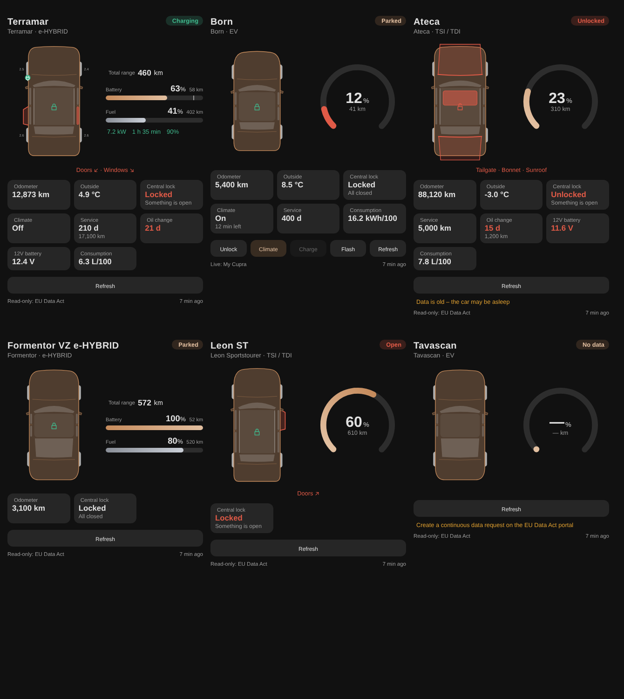

# Cupra для Home Assistant

Интеграция и Lovelace-карточка для автомобилей **CUPRA**: Born, Tavascan, Raval, Terramar, Formentor, Leon, Leon Sportstourer, Ateca. Подходят электромобили, подключаемые гибриды (e-HYBRID) и машины с ДВС.



*[English below](#english)*

## Откуда берутся данные

| Источник | Что даёт | Статус |
|---|---|---|
| **VW Group EU Data Act** (официальный портал) | Батарея, топливо, запас хода, пробег, двери/окна/замок, давление в шинах, ТО и масло, температура снаружи, АКБ 12V, зарядка, расход | ✅ Работает, только чтение, новый снимок каждые ~15 мин |
| **My Cupra (API приложения)** | GPS, живой статус, команды: замок, климат, зарядка, фары/сигнал, «разбудить» | ⚠️ С 8 июня 2026 VW требует токен Firebase App Check и без него отвечает 403. Интеграция пробует подключиться, а при 403 отключает команды и показывает уведомление в «Ремонтах». Повторная попытка — каждые 6 часов |

На EU Data Act нет координат, поэтому `device_tracker` появится только тогда, когда заработает My Cupra.

## Установка

1. HACS → ⋮ → **Пользовательские репозитории** → `https://github.com/keziksdmitrijs-byte/cupra-ha`, тип **Интеграция**.
2. Установите **Cupra** и перезапустите Home Assistant.
3. **Настройки → Устройства и службы → Добавить интеграцию → Cupra**. Введите e-mail и пароль **CUPRA ID** (те же, что в приложении My Cupra).
4. Выберите модель и тип привода или оставьте «Определить автоматически».

Карточка устанавливается вместе с интеграцией, отдельно ставить её через HACS не нужно.

### Подписка на портале EU Data Act (обязательно, один раз)

1. Откройте https://eu-data-act.vwgroup-datahub.com и выберите **CUPRA**.
2. Войдите с CUPRA ID и выберите автомобиль.
3. Создайте **непрерывный (continuous)** запрос данных с интервалом 15 минут.
4. Подождите: первые файлы приходят от нескольких минут до 1–3 дней. Пока данных нет, в «Ремонтах» висит подсказка, а карточка пишет «Ждём первый снимок».

Пока машина спит, портал присылает пустые файлы — это нормально. После короткой поездки или открытия приложения данные обновятся.

## Карточка

```yaml
type: custom:cupra-card
entity: sensor.terramar_vehicle
# необязательно:
name: Моя Cupra
model: terramar        # auto | born | tavascan | raval | terramar | formentor | leon | leon_st | ateca
powertrain: auto       # auto | ev | phev | ice
image: /local/my_car.png   # своя картинка вместо силуэта
show_actions: true
```

У карточки есть визуальный редактор: «Добавить карточку» → **Cupra**.

От типа привода зависит раскладка:

- **EV** — кольцо заряда, запас хода, мощность и время зарядки.
- **PHEV (e-HYBRID)** — общий запас хода, две шкалы (батарея и бензин) с отдельным запасом хода, метка цели зарядки.
- **ДВС** — кольцо уровня топлива, на первом плане ТО и замена масла.

От модели зависит силуэт сверху: хэтчбек (Born, Leon, Raval), универсал (Leon ST), кроссовер (Terramar, Ateca), купе-кроссовер (Formentor, Tavascan). Открытые двери, окна, люк, капот и багажник подсвечиваются на силуэте. По углам выводится давление в шинах, на месте лючка — значок подключённого кабеля.

Вместо силуэта можно показать свою картинку. Положите файл в `/config/www/` (например, `/config/www/my_car.png`) и укажите `image: /local/my_car.png`, это же поле есть в визуальном редакторе. Подойдёт и ссылка `https://…`. Если картинка не загрузится, карточка покажет силуэт.

Кнопки управления (замок, климат, зарядка, фары) видны только при работающем My Cupra. Кнопка «Обновить» есть всегда.

## Сущности

- **Сенсоры:** батарея, цель зарядки, топливо, запас хода (электро / топливо / общий), пробег, состояние и мощность зарядки, время до конца зарядки, температура снаружи, климат, АКБ 12V, ТО (дни/км), замена масла (дни/км), шины, расход и поездки, время последних данных.
- **Бинарные сенсоры:** замок, двери (каждая и общий), окна, люк, капот, багажник, зарядка, кабель, климат, стояночный тормоз, «данные устарели».
- **Диагностика портала:** «Статус EU Data Act» (в атрибутах — последняя ошибка и список полей, которые реально пришли в файле), «Последняя проверка портала», «Файл портала создан».
- **Сводный сенсор** `sensor.<авто>_vehicle` со статусом (припаркован / заряжается / открыт …). В его атрибутах лежит всё, что нужно карточке.
- **My Cupra:** `lock`, переключатели климата, зарядки и обогрева стёкол, кнопки «Фары», «Сигнал и фары», «Разбудить», `device_tracker`.

Сущность создаётся только тогда, когда машина действительно присылает этот сигнал. Если сигнал появится в одном из следующих снимков, сущность добавится автоматически.

### Службы

- `cupra.refresh` — обновить сейчас.
- `cupra.start_climate` — включить климат (`temperature: 16–30`).
- `cupra.command` — `lock`, `unlock`, `climate_on`, `climate_off`, `charging_on`, `charging_off`, `flash`, `honk_flash`, `wakeup`.

## Настройки (Параметры интеграции)

- Модель и тип привода.
- Включить или выключить My Cupra и задать интервал опроса.
- **S-PIN** — нужен для замка.
- **Токен App Check** (для опытных) — если вы достали `X-Firebase-AppCheck` из приложения. Токен со временем истекает.
- Код страны и языка портала — по умолчанию `de`/`en` (как у самого портала). Меняйте, только если вход падает с HTTP 503.

## Если что-то не так

**Нет уровня топлива / батареи, дверей, замка.** Посмотрите атрибут `fields` у сенсора «Статус EU Data Act»: там перечислено всё, что портал положил в файл. Если нужного поля там нет, портал его не присылает. Проверьте, какие группы данных выбраны в вашем запросе на портале, и при необходимости создайте запрос заново со всеми группами.

**«Файл портала создан» обновляется, а «Последние данные» — нет.** Портал выпускает новый файл каждые 15 минут, но внутри лежит последний снимок, который прислала машина. Пока машина не выходит на связь, снимок не меняется.

**Настройки → Устройства и службы → Cupra → ⋮ → Скачать диагностику.** В файле лежат все сырые поля портала и разобранное состояние. VIN, координаты, пароль и токены вырезаются. Пришлите файл в issue — по нему можно добавить недостающие поля для вашей модели.

---

## English

Home Assistant integration + Lovelace card for **CUPRA** cars (EV, e-HYBRID and petrol/diesel).

- **Main data source:** the official **VW Group EU Data Act** portal (read-only, a snapshot every ~15 min). You must create a *continuous* data request once at https://eu-data-act.vwgroup-datahub.com (choose CUPRA).
- **Optional:** the My Cupra app API for GPS and remote commands. Since 8 June 2026 VW requires a Firebase App Check token there. Without it the API returns 403, so the integration switches commands off and raises a Repairs issue instead of failing.
- Install through HACS as a custom repository (type *Integration*). The card (`custom:cupra-card`) is bundled and registered automatically. Its layout follows the powertrain, and the car outline follows the model.
- Translations: English, Russian, Latvian.

## Credits

- EU Data Act login flow and data dictionary: [HA_VAG-EU-Data-Act](https://github.com/TommiG1/HA_VAG-EU-Data-Act) (MIT).
- My Cupra API knowledge: [pycupra](https://github.com/WulfgarW/pycupra) (Apache-2.0).

See [THIRD_PARTY_NOTICES.md](THIRD_PARTY_NOTICES.md). Not affiliated with SEAT, CUPRA or the Volkswagen Group.
